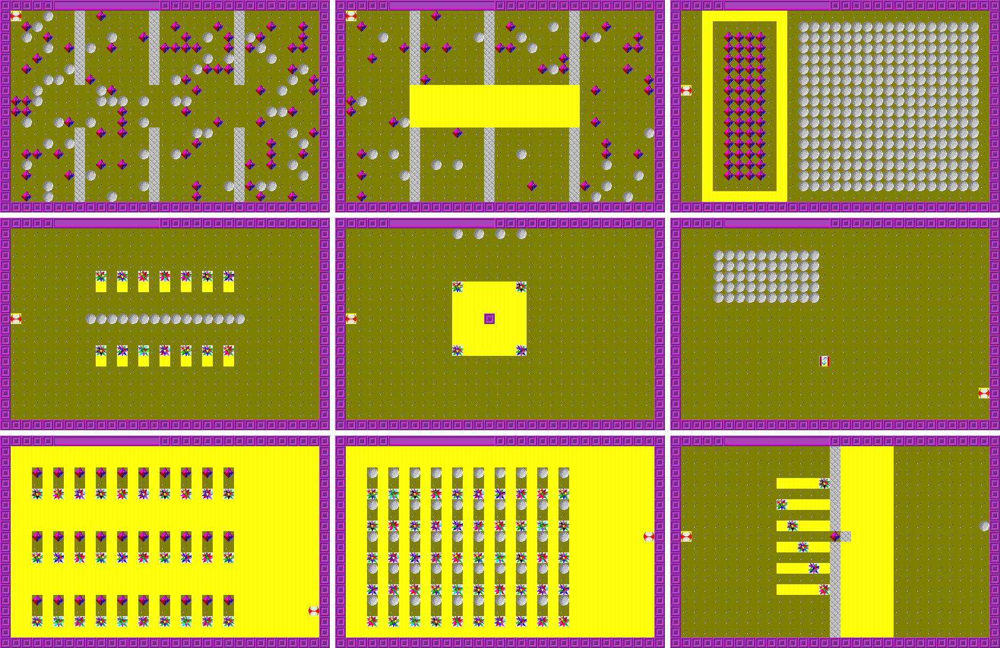

# ROCK, in Rust

A port of **ROCK** (Dale O'Brien, January 1993, "Beta Verison 1.0"), originally
written in Borland Turbo Pascal for Windows 1.5 for Windows 3.x. This folder
holds the Rust version and everything extracted from `ROCK20.RES`. The
original Pascal source is in [`Org Pascal/`](Org%20Pascal/); see
[The original source](#the-original-source) for what each file is.

## Build and run

You need a Rust toolchain (https://rustup.rs).

    cargo run --release

It uses [macroquad](https://macroquad.rs), so it builds as-is on Windows,
macOS and Linux (on Linux it needs the usual X11/GL development libraries).
All the bitmaps are compiled into the binary, so `target/release/rock` runs on
its own.

`cargo test` runs the tests. One of them plays every level for 3,000 random
moves and checks the result against a fingerprint recorded from the first,
line-by-line version of the port, so any accidental change to how the game
plays or looks is caught.

## The game

It is a Boulder Dash–style game played on a 31 x 20 grid of 20-pixel cells.

* **Arrow keys** move the man, digging through earth. **Shift + arrow** digs
  or picks up a diamond in that direction without moving (it also pushes a
  boulder without stepping after it).
* **Boulders and diamonds** fall into empty space and roll off anything round
  or hard. One falling onto your head kills you. Boulders can be pushed sideways
  into empty space.
* **Diamonds** fill the purple score bar at the top. Once you have the
  level's quota, the **door** appears at the flashing exit cell; walk into it
  to go to the next level.
* **"Life" creatures** (the spinning starbursts) crawl around the edges of
  open space, half of them hugging the left wall and half the right. If one
  touches you, you die. Drop something on one, or box it in for about 6
  seconds, and it explodes into a 3 x 3 block of diamonds.
* **The morph** (level 6) is a magic wall. A rock dropped onto it comes out
  underneath as a diamond, and a diamond comes out as a boulder.
* When you die ("Death says .. You are mine !") the level restarts. Getting
  through level 9 shows "You have escaped Death / All done" and goes back to
  level 1.
* **Menu:** *About* shows the credit box. *Level* asks "Enter 1..9" and jumps
  to that level.

The levels: (1) 67 diamonds among three walls; (2) 35 diamonds with 3
creatures in a corridor; (3) a diamond vault guarded by 8 creatures next to a
solid block of boulders; (4) 14 creatures in pockets around a line of
boulders; (5) 20 diamonds needed but none on the map, so you have to blow up the
4 creatures, and the exit is in the middle; (6) the morph under a block of
boulders; (7) 30 creatures under diamonds; (8) 50 creatures under boulders; (9)
2 diamonds and 12 creatures behind a wall.

The "random" diamonds and boulders in levels 1 and 2 are the same every time,
because the original resets Turbo Pascal's random seed to `$FFFF` at the start
of every level. The port uses Turbo Pascal's exact generator, which I checked
against the code linked into `ROCK.EXE`, plus the original's order of
evaluating the row and column, so the layouts match the original.

## The original source

The port is based entirely on the original 1993 program, whose files are
kept unchanged in [`Org Pascal/`](Org%20Pascal/) in this repository. The game rules were ported line by
line from the Pascal units, every image came out of the resource file, and the
random-number behaviour was checked against the compiled program.

| File | Date | What it is |
|---|---|---|
| `ROCK.PAS` | 25 Apr 1993 | The main program: the ObjectWindows application and window, the 200 ms timer, keyboard and mouse handlers, painting, and the About and Level menu commands. Its `{$D}` line reads "Dale O'Brien, Beta Verison of Rock, 1993, Jan, Coded using Borland TPW 1.5". |
| `ROCK_FUC.PAS` | 24 Apr 1993 | The `Rock_Fuc` unit: the game logic (level setup, falling and rolling, the creatures, the morph, scoring, drawing cells). Ported to `src/game/`. |
| `ROCK_VAR.PAS` | 24 Apr 1993 | The `Rock_Var` unit: grid size, constants, types and the global game state. Ported to `src/game/`. |
| `ROCK20.RES` | 25 Apr 1993 | The Windows 3.x resource file linked in with `{$R rock20.res}`: 31 bitmaps, the icon and the menu. Extracted into `resources/`. |
| `ROCK.EXE` | 25 Apr 1993 | The compiled 16-bit Windows program. Used to confirm the resources and Turbo Pascal's `Random`. |
| `ROCK_FUC.TPU`, `ROCK_VAR.TPU` | 24 Apr 1993 | Compiled Turbo Pascal units for the two `.PAS` units. |
| `ROCK.RTF` | 15 Jan 1993 | The start of a WinHelp help file that was never finished or hooked up. |

To build the original you would need Borland Turbo Pascal for Windows 1.5
(its `WObjects`, `WinTypes`, `WinProcs`, `Strings`, `StdDlgs` and `WinCrt`
units) and Windows 3.x to run it.

## Layout

| Path | What it is |
|---|---|
| `Org Pascal/` | The original 1993 Turbo Pascal source, resources and compiled program |
| `src/game/mod.rs` | The `Game` type the window drives: timer, keys, menu commands and message boxes |
| `src/game/tile.rs` | What a cell can hold (boulder, diamond, creature frame...) and what each kind does |
| `src/game/board.rs` | The 31 x 20 board, positions and directions |
| `src/game/physics.rs` | Falling and rolling, and the morph |
| `src/game/creatures.rs` | The wall-following creatures |
| `src/game/player.rs` | Moving, digging, pushing and dying |
| `src/game/levels.rs` | The nine levels |
| `src/game/render.rs` | The framebuffer and bitmaps it draws into |
| `src/game/tests.rs` | Tests |
| `src/rng.rs` | Turbo Pascal's `Random`, bit for bit |
| `src/main.rs` | Window, 200 ms timer, keyboard, scaling |
| `src/ui.rs` | Windows 3.1-style menu bar, message boxes and the Level input dialog |
| `src/assets.rs` | Embeds the PNGs from `resources/` into the binary |
| `src/script.rs` | Scripted input for automated screenshots (only used if `ROCK_SCRIPT` is set) |
| `resources/` | Everything extracted from `ROCK20.RES` (see below); the game builds its images in from here |
| `tools/extract_res.py` | The extractor for 16-bit `.RES` files (needs Pillow) |
| `screenshots/` | The port running |

### What was in ROCK20.RES

All of it is also embedded byte-for-byte in `ROCK.EXE`, so the `.RES` file matches the
shipped program.

* **31 bitmaps**, 20 x 20 except the 2 x 20 score-bar strips, in 16- and
  256-colour DIB format → `resources/bitmaps/*.png`. Overview:
  `resources/contact_sheet.png`. `CHERRY` and `DIA256` are in the file but the
  program never loads them, and `MORPH4` is loaded but never shown.
* **1 icon** (32 x 32, 16 colours) → `resources/icons/icon.ico` and `.png`.
  The port uses it as its window icon.
* **1 menu** `MENU_1`: `&About` (100), `&Level` (200) → `resources/menus/menu_1.json`
* There are no dialog, string table or cursor resources. The Level dialog
  came from Borland's `StdDlgs` unit, not from this file.
* `resources/manifest.json` lists every resource in the file.

## How faithful is it

The game logic was first ported statement by statement and then reorganised
into idiomatic Rust, with a test checking that it still plays exactly the same.
The screen is drawn the same way as the original. The original never kept a picture of the screen: it `BitBlt`ed each
cell straight to the window as it changed and flashed the exit with
`InvertRect`. The port keeps a 620 x 400 framebuffer and does the same blits
into it, so things like the flashing exit and the stretched score bar look the
same.

**Bugs in the original that the port fixes:**

* **Dialogs pause the game.** In the original, the 200 ms timer kept running
  behind message boxes and the Level dialog, so creatures kept moving and you
  could even die while reading the About box.
* **The Level dialog does what it says.** It opens showing the current level
  and only accepts a single digit from 1 to 9. **Cancel** leaves the game
  alone. The original remembered the last thing typed, because it wrote into
  the string constant `'1'`, and it changed level even on Cancel. It also took
  any character, so `0` or an empty box loaded the level 1 layout under the
  wrong level number, and `:` jumped straight to "All done".
* **Falling things roll either way.** The original's `Random(1) < 0.5` is
  always true, so boulders and diamonds always tried to roll right first.
  It is now a real 50/50.
* **The morph stays on level 6.** The original never cleared `Morphic[0]`,
  so once you had played level 6, a morph kept appearing at column 15, row 14
  on every later level. On earlier levels it wrote to `Map[0,0]`, outside the
  map, every tick.
* **Only the arrow keys do anything.** In the original any key made the man
  blink, and pressing Shift while holding an arrow stopped the arrow
  repeating.

**Kept as they were:**

* There is no sound. The original has `MessageBeep` calls, but its `Sound`
  flag is always False.
* Mouse clicks on the board do nothing. The original works out the cell and
  then ignores it.
* The level layouts, including the scattered diamonds and boulders, are the
  same as the original's.

**What couldn't be reproduced exactly:**

* **Window size.** The original asked for a 620 x 440 window *including* the
  caption, menu and dialog frame, so its client area was a little smaller
  than the 620 x 400 board. The right-hand column and bottom row were partly
  cut off. The port shows the whole board, and the window can be resized, with
  whole-number pixel scaling where it fits (it opens at 2x).
* **Windows 3.1 look.** The menu bar, message boxes and input dialog are
  redrawn to look like Windows 3.1, but they use macroquad's built-in font
  instead of the System font, and the sizes are close, not exact. There is
  no keyboard menu navigation (F10 / Alt alone); Alt+A and Alt+L work.
* **Colours.** The bitmaps are shown in full colour. On a typical 1993
  16-colour VGA driver, the 256-colour bitmaps (man, creatures, door, falling
  boulder) would have been mapped to the nearest of the 16 system colours, so
  the original probably looked harsher. The exit flash inverts RGB values,
  which matches what the 16 standard colours did.
* **Keyboard repeat.** The original moved at whatever repeat rate Windows was
  set to. The port copies the Windows defaults (about 500 ms delay, then 30
  repeats a second).
* **Out-of-range memory access.** Besides the morph write above, the
  original paint routine read row and column 0, outside the map. That read
  never changed anything visible, and the port doesn't do it. The map array
  also has a border of padding cells, so any stray access stays harmless.
* **Repainting after a dialog.** Windows repainted only the area a closed
  dialog had covered. The port repaints the whole board, which can change
  which phase the exit flash is in.
* `ROCK.RTF` is the start of a WinHelp help file that was never hooked up, so
  there is nothing to port. The Mac files in the `ROCK` folder
  (`ROCK.xcodeproj`, `Start.pas`, `MainUnit.pas`) are a separate Free
  Pascal/Carbon project and were left alone.

## Re-extracting the resources

Point the extractor at `ROCK20.RES` in the original source folder. On Dale's
Mac:

    python3 tools/extract_res.py "Org Pascal/ROCK20.RES" resources
