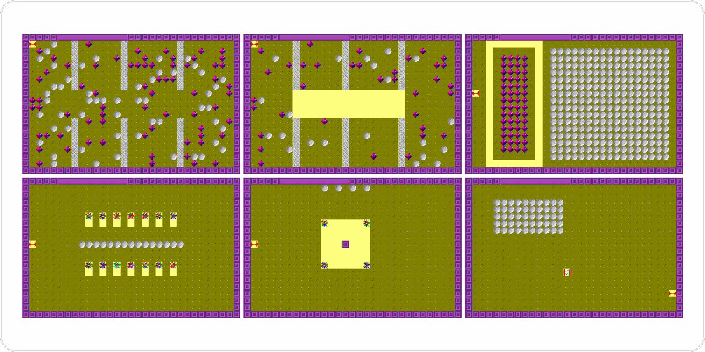

<h1 align="center">ROCK</h1>

<p align="center">A Rust port of ROCK, a boulders-and-diamonds game I wrote for Windows 3.x in 1993.</p>

<p align="center">
  <a href="https://rock.do.id.au/"><b>Play it</b></a> &nbsp;·&nbsp;
  <a href="#quick-start">Quick start</a> &nbsp;·&nbsp;
  <a href="#documents">Documents</a> &nbsp;·&nbsp;
  <a href="#how-it-works">How it works</a>
</p>

<p align="center">
  
</p>

ROCK (January 1993, "Beta Verison 1.0") was written in Borland Turbo Pascal
1.5 for Windows. Dig through the earth with the arrow keys, collect each
level's quota of diamonds, and get out through the door, without being
crushed by a falling boulder or caught by the spinning creatures. This port
keeps the original's nine levels, rules and bitmaps, fixes a handful of its
bugs, and runs on macOS, Windows, Linux and in a web browser. The original
Pascal source is kept unchanged in [`Org Pascal/`](Org%20Pascal/).

## Quick start

```bash
make run      # the game in a window (cargo run --release)
make test     # including a replay of every level against a recorded fingerprint
make serve    # the browser version at http://localhost:8000
make          # the rest
```

You need a Rust toolchain from [rustup.rs](https://rustup.rs). On Linux it also
needs the usual X11/GL development libraries.

## Documents

| Document | What's in it |
| -------- | ------------ |
| [The game](docs/game.md) | The controls, the rules, the creatures and the morph, the nine levels, and where your level is saved |
| [How faithful is it](docs/faithful.md) | The original's bugs the port fixes, what's kept as it was, and what couldn't be reproduced exactly |
| [The original source](docs/original.md) | Each file in `Org Pascal/`, what was in `ROCK20.RES`, and re-extracting it |
| [Building and the code](docs/development.md) | Building, the tests, the web version and its deploy, and the source layout |

## How it works

The game logic was ported statement by statement from the Pascal units, then
reorganised into idiomatic Rust, with a test that plays every level for 3,000
random moves and checks the result against the line-by-line port. Every bitmap
came out of the original's resource file, and the random layouts use Turbo
Pascal's own `Random`, checked against the compiled `ROCK.EXE`, so they match
the original exactly. The screen is a 620 × 400 framebuffer that the game blits
cells into the way the original blitted them to its window, drawn with
[macroquad](https://macroquad.rs), which also builds it for WebAssembly.

---

<p align="center"><sub>Part of <a href="https://daleobrien.github.io/#games">Games</a> &nbsp;·&nbsp; more at <a href="https://daleobrien.github.io">daleobrien.github.io</a></sub></p>
