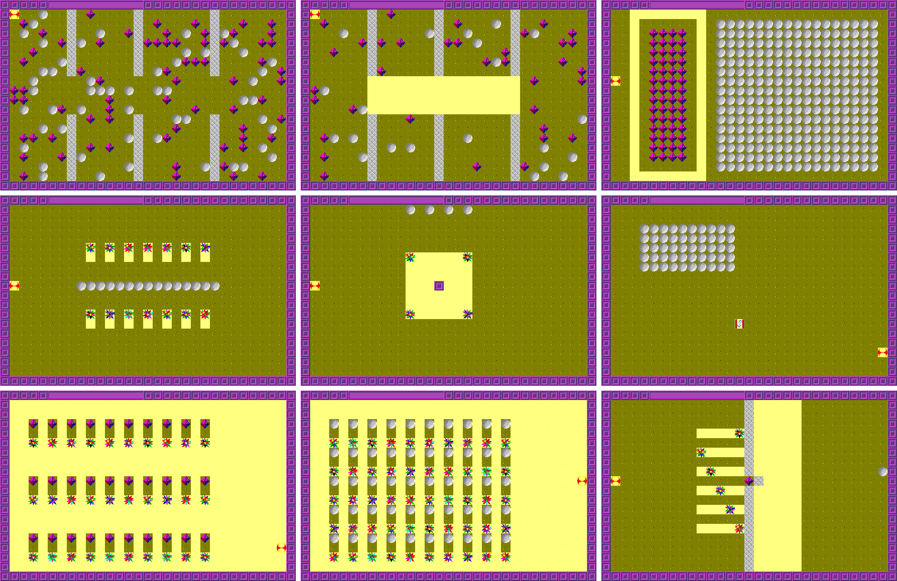

# The game

[Back to the README](../README.md)

It is a Boulder Dash–style game played on a 31 x 20 grid of 20-pixel cells.

* **Arrow keys** move the man, digging through earth. **Shift + arrow** digs
  or picks up a diamond in that direction without moving (it also pushes a
  boulder without stepping after it).
* **Boulders and diamonds** fall into empty space and roll off anything round
  or hard. One falling onto your head kills you. Boulders can be pushed sideways
  into empty space.
* **Diamonds** fill the purple score bar at the top. Once you have the
  level's quota, the **door** appears at the flashing exit cell; walk into it
  to go to the next level.
* **"Life" creatures** (the spinning starbursts) crawl around the edges of
  open space, half of them hugging the left wall and half the right. If one
  touches you, you die. Drop something on one, or box it in for about 6
  seconds, and it explodes into a 3 x 3 block of diamonds.
* **The morph** (level 6) is a magic wall. A rock dropped onto it comes out
  underneath as a diamond, and a diamond comes out as a boulder.
* When you die ("Death says .. You are mine !") the level restarts. Getting
  through level 9 shows "You have escaped Death / All done" and goes back to
  level 1.
* **Menu:** *About* shows the credit box. *Level* asks "Enter 1..9" and jumps
  to that level.
* The port remembers the level you're on and starts there next time. (The
  original always started at level 1.) It's saved each time a level starts,
  in `level.txt` in your user data folder:
  `~/Library/Application Support/Rock/` on macOS, `%APPDATA%\Rock\data\` on
  Windows, and `$XDG_DATA_HOME/rock/` (usually `~/.local/share/rock/`) on
  Linux. Delete the file, or use *Level*, to start again from level 1.

## The levels

The levels: (1) 67 diamonds among three walls; (2) 35 diamonds with 3
creatures in a corridor; (3) a diamond vault guarded by 8 creatures next to a
solid block of boulders; (4) 14 creatures in pockets around a line of
boulders; (5) 20 diamonds needed but none on the map, so you have to blow up the
4 creatures, and the exit is in the middle; (6) the morph under a block of
boulders; (7) 30 creatures under diamonds; (8) 50 creatures under boulders; (9)
2 diamonds and 12 creatures behind a wall.

The "random" diamonds and boulders in levels 1 and 2 are the same every time,
because the original resets Turbo Pascal's random seed to `$FFFF` at the start
of every level. The port uses Turbo Pascal's exact generator, which I checked
against the code linked into `ROCK.EXE`, plus the original's order of
evaluating the row and column, so the layouts match the original.

The layouts are now kept as text files in [`levels/`](../levels/), one per
level, with the board drawn out cell by cell. They were generated from the
original's level code, so they include those scattered diamonds and boulders
exactly where the original put them.
